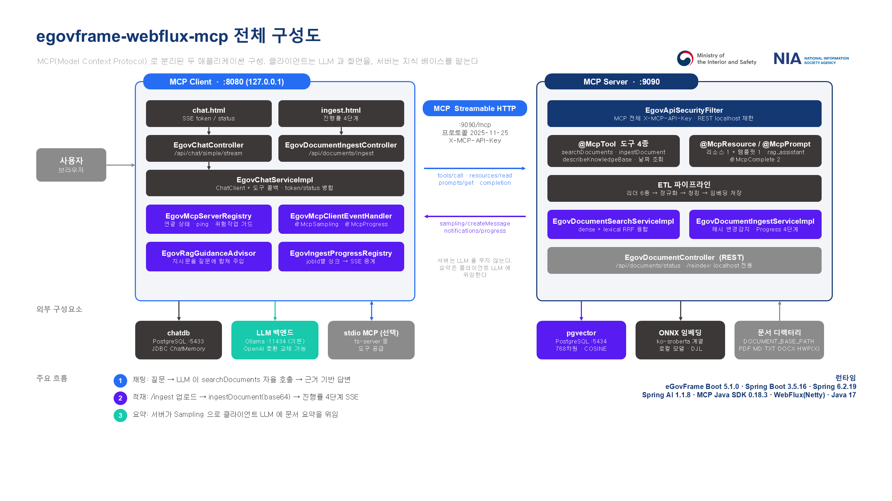
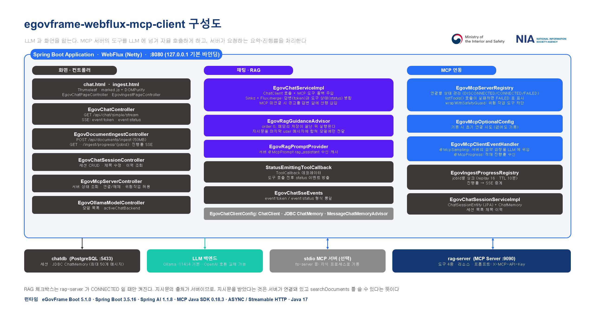

# egovframe-webflux-mcp-client

[![eGovFrame](https://img.shields.io/badge/eGovFrame-5.1.0-134F8C?labelColor=white&logo=%2BPHBhdGggZmlsbD0iI2U0MDMyZSIgZD0iTTE2NC43ODggNjIuNTg5Yy00Ljc3Ny0xNi4wMjYtMjcuMTUzLTQ3LjU3MS02Ny4yODItNDcuNTcxLTM3Ljg5NCAwLTY0LjIxNCAyOC41NjMtNjQuMjE0IDU0LjIxMiAwIDQuNzU5LjI5IDYuOTAxIDEuNDY2IDExLjM2OC0uNDg5LTEuOTUxLS43NC0zLjkwOC0uNzQtNS44MjMgMC0yNi43MjEgMjYuNzQxLTQ1LjIyNyA1NC4yNDgtNDUuMjI3IDM3LjIxOCAwIDY3LjM4OCAzMC4xNzQgNjcuMzg4IDY3LjM5IDAgMjkuMTczLTE2Ljc4NSA1NC40MzctNDEuMTc5IDY2LjU2NXYuMDIzYzMxLjQ1NS0xMS4zOTEgNTMuOTA4LTQxLjUxMiA1My45MDgtNzYuODg0IDAtOC4zNzgtMS4xMjctMTUuNzU5LTMuNTk1LTI0LjA1MyIvPjwvc3ZnPg%3D%3D)](https://www.egovframe.go.kr)
[](https://openjdk.org/projects/jdk/17/)
[](https://spring.io/projects/spring-boot)
[](https://spring.io/projects/spring-ai)
[](https://ollama.com/)
[](https://github.com/pgvector/pgvector)

Spring AI MCP 클라이언트 기반의 RAG 채팅 애플리케이션이다.
Ollama 로컬 LLM과 egovframe-webflux-mcp-server(:9090)를 연결해 문서 기반 질의응답과 일반 대화를 제공한다.

---

## 목차

- [공통 환경](#공통-환경)
- [이 프로젝트 설정](#이-프로젝트-설정)
- [아키텍처](#아키텍처)
- [사전 준비](#사전-준비)
- [빌드 및 실행](#빌드-및-실행)
- [주요 기능](#주요-기능)
- [REST API](#rest-api)
- [프로젝트 구조](#프로젝트-구조)
- [application.yml 주요 설정](#applicationyml-주요-설정)
- [트러블슈팅](#트러블슈팅)
- [라이선스](#라이선스)

---

## 공통 환경

| 항목 | 버전 |
| :--- | :--- |
| JDK | 17 |
| 표준프레임워크 실행환경 | 5.1.0 |
| Spring Boot | 3.5.16 |
| Spring AI | 1.1.8 |
| Maven | 3.9.13 |
| Docker | 29.7.2 |
| Ollama | 0.40.12 |

- 표의 버전은 동작을 확인한 값이다. 최소 0.17.1 이상을 쓴다. 그 이전 버전에는 GGUF 모델을
  읽는 과정에서 프로세스 메모리가 새어 나갈 수 있는 취약점(CVE-2026-7482)이 있다.

---

## 이 프로젝트 설정

| 항목 | 값 |
|------|-----|
| 서버 포트 | 8080 (`127.0.0.1` 바인딩, `BIND_ADDRESS` 로 변경) |
| MCP 서버 | http://localhost:9090 (ASYNC / Streamable HTTP) |
| 채팅 DB | PostgreSQL (localhost:5433, DB: chatdb) |
| Ollama | http://localhost:11434, 기본 모델: qwen3-4b:Q4_K_M (예시) |
| 채팅 UI | http://localhost:8080 |
| 문서 적재 UI | http://localhost:8080/ingest |

---

## 아키텍처

MCP 로 분리된 두 애플리케이션이 어떻게 맞물리는지, 그리고 이 클라이언트 안이 어떻게 나뉘는지를 보여준다.





---

## 사전 준비

### 1. MCP 서버 기동 (권장)

서버 없이도 클라이언트 단독 기동이 가능하다. 단, RAG 채팅·문서 적재는 서버 연결 시에만 동작한다.

서버 프로젝트 루트에서 실행한다.

```bash
mvn spring-boot:run
```

### 2. PostgreSQL (chatdb)

세션 정보와 채팅 메모리를 저장하는 전용 DB다 (서버의 mcpdb:5434와 별개). 프로젝트 루트에서 실행한다.

```bash
docker compose up -d
```

PostgreSQL 16 이 5433 포트로 뜬다. 테이블은 첫 실행 때 애플리케이션이 만든다. 채팅 메모리는 `initialize-schema: always`, 세션 목록은 JPA `ddl-auto: update` 가 맡는다.

### 3. Ollama

Tool Calling을 지원하는 모델이 필요하다.

```bash
ollama pull <모델명>
```

`application.yml` 의 `spring.ai.ollama.chat.options.model` 에는 직접 pull 하거나 등록한 모델 이름을 적는다. 기본값 `qwen3-4b:Q4_K_M` 은 예시이다.

#### 다른 LLM 백엔드로 바꾸려면

기본 백엔드는 Ollama이며, `pom.xml`에는 Ollama 스타터만 들어 있다. OpenAI 호환
백엔드(OpenRouter 등)로 바꾸려면 **의존성을 먼저 추가해야 한다.** 설정만 바꾸면
기동되지 않는다.

```xml
<dependency>
    <groupId>org.springframework.ai</groupId>
    <artifactId>spring-ai-starter-model-openai</artifactId>
</dependency>
```

```yaml
spring:
  ai:
    model:
      chat: openai            # OllamaChatAutoConfiguration 이 꺼진다
    openai:
      base-url: https://openrouter.ai/api
      api-key: ${OPENROUTER_API_KEY}
      chat:
        options:
          model: openai/gpt-4o-mini
```

바뀌는 것은 채팅 모델뿐이고, 채팅 화면의 모델 드롭다운은 비활성화되고 모델은 서버 설정을 따른다
(아래 「주요 기능」 참고). `EgovOllamaConfig` 는 Ollama 전용 타임아웃 설정이라 이때는 쓰이지
않는다. 잠깐 바꿔 쓰는 동안에는 그냥 둬도 되고, OpenAI 로 계속 갈 거라면 지운다.

### 4. 환경변수

| 변수 | 설명 | 기본값 |
|------|------|--------|
| `MCP_API_KEY` | 서버 MCP 엔드포인트 인증 키. 서버의 `app.security.api-keys`와 동일한 값으로 설정. 연결 단위 헤더이므로 검색과 적재 모두에 적용. 등록된 **모든 HTTP MCP 서버 연결**에 같은 키가 붙는다(stdio 연결은 제외). | 빈 문자열 (서버 연결 실패) |
| `MCP_SERVER_URL` | 연결할 MCP 서버 주소. 서버를 별도 PC에서 띄운 경우 해당 PC의 LAN IP로 설정 (예: `http://192.168.0.10:9090`). | `http://localhost:9090` |
| `OLLAMA_BASE_URL` | 채팅·Sampling 에 쓸 Ollama 주소. 도커 컨테이너나 다른 PC 에 띄운 경우 그 주소로 설정 (예: `http://192.168.0.20:11434`). | `http://localhost:11434` |
| `OLLAMA_HOST` | Ollama CLI 가 접속할 주소. 화면의 모델 목록과 배지는 이 앱을 실행하는 PC 의 `ollama list`·`ollama --version` 명령으로 판정하므로, 원격 Ollama 를 쓸 때는 `OLLAMA_BASE_URL` 과 같은 주소로 맞춘다. 이 PC 에 Ollama CLI 가 없으면 원격 Ollama 가 정상이어도 배지가 `Ollama 연결 안 됨` 으로 나오고 입력창이 잠긴다(백엔드가 Ollama 일 때). | Ollama CLI 기본값 |
| `BIND_ADDRESS` | 이 앱이 바인딩할 주소. **기본은 로컬 전용**이며, 이 앱의 REST 엔드포인트에는 인증이 없으므로 외부에 열기 전 접근 통제가 먼저 필요. | `127.0.0.1` |
| `CLIENT_UPLOAD_DIR` | 아래 「stdio MCP 서버」 예시를 등록했을 때만 사용. 파일시스템 MCP 서버가 노출할 루트 디렉터리이며 **실제로 존재해야 함.** | 없음 (기본 설정에 stdio 서버 없음) |

---

## 빌드 및 실행

프로젝트 루트에서 실행한다.

```bash
mvn clean compile
mvn test
mvn spring-boot:run
```

### 테스트

`mvn test` 결과는 32개다. Spring 컨텍스트를 띄우지 않는 단위·슬라이스 테스트이므로 DB·Ollama·MCP 서버가 없어도 돌아간다.

> `@Mcp*` 핸들러를 추가·수정했다면 `EgovMcpClientEventHandlerTest` 를 함께 돌린다.
> 핸들러 등록에 실패하면 예외 대신 기동 로그에 WARN 한 줄만 남으므로, 기능 테스트로는 걸리지 않는다.

---

## 주요 기능

### 채팅 UI (`/` → chat.html)

- **단일 탭**: 연결된 MCP 서버의 도구 전체를 LLM에 제공하고, 도구를 부를지는 LLM이 질문을 보고 정한다. 문서 검색이 필요한 질문이면 LLM이 `searchDocuments`를 호출한다.
- **MCP 미연결 경고**: 서버가 등록돼 있으나 연결된 도구가 없으면 `"*MCP 서버 미연결 - RAG 없이 응답합니다*"` 경고를 답변 앞에 붙인다.
- **도구 호출 상태 표시**: LLM이 MCP 도구를 호출하는 동안 답변 영역에 "도구명 호출 중..." / "완료, 답변 생성 중..."을 표시한다. 상태는 SSE `event:status` 이벤트로 전달되며, 도구를 쓰지 않으면 "응답 생성 중..."이 그대로 남는다.
- **세션 관리**: 사이드바에서 세션 목록을 보고 고르거나 지운다. 제목은 첫 메시지 앞 30자로 자동 생성되고 답변이 끝나면 바로 반영된다. 목록에서 제목을 바로 고칠 수 있다.
- **채팅 이력 복원**: 세션을 고르면 JDBC ChatMemory에서 이전 대화를 불러온다. 세션마다 최근 50개 메시지(질문과 답변을 각각 하나로 셈)까지만 보관하고, 넘친 오래된 메시지는 DB에서도 지운다(`app.chat.memory.max-messages`).
- **Ollama 모델 선택**: 드롭다운으로 모델을 바꾼다. 백엔드가 Ollama가 아니면 드롭다운이 비활성화되고 모델은 서버 설정을 따른다(전환 방법은 「사전 준비 → 3. Ollama → 다른 LLM 백엔드로 바꾸려면」).
- **LLM 백엔드 상태 표시**: 모델 드롭다운 옆 배지에 `사용 가능: N개` / `Ollama 연결 안 됨 - 채팅할 수 없습니다` / `설치된 모델 없음` 중 하나를 표시한다. 질의할 수 없는 상태면 **입력창과 전송 버튼이 잠긴다**. 배지에 마우스를 올리면 서버가 보낸 사유가 보인다. 백엔드가 Ollama 일 때 이 판정은 실제 채팅 요청이 아니라 이 앱을 실행하는 PC 의 Ollama CLI 결과로 한다(환경변수 표의 `OLLAMA_HOST` 참고).
- **`문서 기반으로 답하기` 체크박스 (RAG 지시문)**: 켜면 서버의 `rag_assistant` 프롬프트(문서를 먼저 검색하라는 지시문)를 질문에 덧붙여 모델에 보낸다. 지시를 잘 따르지 않는 소형 모델이 검색을 건너뛰는 경우를 보완하는 기능이며, 도구 제공 여부와는 상관없다. `rag-server` 가 `CONNECTED` 일 때만 켤 수 있고, 인증 실패로 막힌 경우에는 툴팁이 `MCP_API_KEY` 를 안내한다(연결 버튼으로는 풀리지 않기 때문이다).
- **마크다운 렌더링 + XSS 스크립트 제거**: `marked.js` 로 마크다운을 HTML 로 바꾸고, `DOMPurify` 로 그 HTML 에서 스크립트와 이벤트 핸들러 속성을 걸러낸 뒤 화면에 넣는다.

### 문서 적재 UI (`/ingest` → ingest.html)

- 파일을 선택하거나 끌어다 놓는다(PDF / DOCX / HWP / HWPX / 마크다운 / 텍스트, 최대 50MB). 바이너리는 base64 로 바꾸면 약 1.33배 커지므로, 서버의 요청 크기 한도(서버 `spring.http.codecs.max-in-memory-size`, 기본 50MB)에 먼저 걸릴 수 있다. 큰 바이너리는 약 37MB 이하로 올리거나 서버 한도를 늘린다.
- 텍스트(`.md`·`.txt`)는 UTF-8 그대로, 바이너리는 base64로 실어 MCP `ingestDocument` 도구를 호출한다.
- 적재 진행률을 4단계(텍스트 추출 → 요약 → 청킹 → 임베딩)로 표시한다. 서버의 Progress 알림을 SSE로 화면에 전달한다.
- 업로드한 원본 파일을 서버의 문서 폴더에 보관하지 않는다. 서버는 파일에서 텍스트를 추출해 정규화·(설정 시)마스킹·청킹한 결과와 요약·메타데이터를 DB에 저장한다. HWPX 는 서버가 파싱하는 동안 임시 파일을 썼다가 지운다.
- 코드가 파일 바이트를 그대로 보내므로 모델이 내용을 다시 쓰지 않는다. 채팅으로 적재를 지시하면 모델이 내용을
  다시 써서 보내므로, 원본 파일 그대로 적재해야 하면 이 화면을 쓴다.

### MCP 서버 레지스트리 (`EgovMcpServerRegistry`)

서버를 이름으로 구분하고 상태를 서버마다 따로 관리한다.

#### 서버 상태

| 상태 | 의미 |
|------|------|
| `DISCONNECTED` | 연결 시도 전, 또는 [해제]로 연결을 끊은 상태. |
| `CONNECTED` | `initialize()` 성공. 이때 도구 목록도 함께 조회하는데, 그 조회가 실패해도 상태는 CONNECTED 이고 도구 목록만 비어 있다. |
| `FAILED` | 연결 시도 중 예외(서버 없음·인증 실패 등), 또는 채팅 중 응답 확인 실패. |

#### 사이드바 동작

| 상황 | 동작 |
|------|------|
| 기동 시 서버 연결 성공 | CONNECTED(녹색). 즉시 MCP 도구 사용 가능. |
| 기동 시 서버 없음 | 기동 직후 백그라운드 연결 시도가 실패해 FAILED(빨간색). 일반 채팅만 가능. 서버를 띄운 뒤 사이드바 [재시도]. |
| 채팅 요청 시 서버 응답 없음 | 그 서버를 FAILED(빨간색)로 바꾼다. 연결된 도구가 하나도 남지 않으면 답변 앞에 미연결 경고를 붙인다. |
| [연결]·[재시도] 버튼 클릭 | DISCONNECTED·FAILED 서버에 다시 연결한다. 이미 CONNECTED 인 서버에는 아무것도 하지 않으므로, 강제로 다시 연결하려면 [해제] 후 [연결]. |
| 새로고침(↻) 버튼 클릭 | 레지스트리가 보관한 상태를 다시 읽어 표시한다. 서버에 응답을 확인하지는 않는다. |

#### 서버 응답 확인

채팅 요청마다 `getToolCallbacks()` 가 **CONNECTED 인 서버에만** `listTools()` 를 보내 응답을 확인한다.
응답이 없으면 그 서버를 FAILED 로 바꾼다. DISCONNECTED·FAILED 서버에 자동으로 다시 연결하지는 않는다.
미연결 경고는 등록된 서버가 있는데 연결된 도구가 하나도 없을 때만 붙으므로, 다른 서버의 도구가 남아 있으면 `rag-server` 가 실패해도 경고가 없을 수 있다.

#### stdio MCP 서버 지원

**기본 설정에는 stdio 서버가 없다.** `connections: {}` 로 비어 있으며, 필요한 서버를 직접 등록한다. 등록하면 클라이언트가 자식 프로세스로 띄우고, 사이드바에 서버가 하나 더 생겨 연결·해제·도구 목록이 `rag-server` 와 똑같이 동작한다.

아래는 파일시스템 서버를 붙이는 예시다. **다른 stdio MCP 서버도 같은 방식이고**, 여러 개를 둘 수도 있다.

```yaml
spring:
  ai:
    mcp:
      client:
        stdio:
          connections:
            fs-server:
              command: "cmd"                 # Windows: cmd /c 필수 (npx는 .cmd 스크립트)
              args: ["/c", "npx", "-y",
                     "@modelcontextprotocol/server-filesystem",
                     "${CLIENT_UPLOAD_DIR:}"]
```

> Linux/macOS: `command: "npx"`, `args: ["-y", "@modelcontextprotocol/server-filesystem", "${CLIENT_UPLOAD_DIR:}"]`

이 예시를 쓰려면 셋이 갖춰져야 한다. 하나라도 빠지면 **그 서버만** FAILED 가 된다. 초기 연결은 기동과 별도로 백그라운드에서 서버를 하나씩 시도하므로 기동 자체는 늦어지지 않는다. 다만 서버 하나의 연결 시도가 끝날 때까지(응답 대기 최대 15초) 같은 레지스트리를 쓰는 상태 조회·채팅·적재 요청이 잠시 기다릴 수 있다. 다른 서버의 연결 상태는 바뀌지 않는다.

1. Node·`npx` 설치 (폐쇄망은 미리 반입. [서버 README](https://github.com/eGovFramework/egovframe-webflux-mcp-server) 의 「폐쇄망에서 stdio MCP 서버 준비하기」 참고)
2. `CLIENT_UPLOAD_DIR` 이 가리키는 디렉터리가 실제로 존재
3. OS 에 맞는 `command`/`args` (위 Windows / Linux·macOS 구분)

> **적재에는 필요 없다.** `/ingest` 화면은 브라우저가 올린 파일을 컨트롤러가 직접 읽어 MCP `ingestDocument` 로 보낸다. 파일 읽기 도구는 채팅에서 "이 경로의 파일을 적재해줘" 라고 지시하는 경로에만 필요하고, 그 경로는 LLM 이 내용을 다시 쓰므로 원본과 달라질 수 있다([서버 README](https://github.com/eGovFramework/egovframe-webflux-mcp-server) 참고).

> Spring AI 의 프로퍼티 키에 적지만 연결은 자동 구성이 아니라 `EgovMcpServerRegistry` 가 한다.

#### 위험 작업 제어

각 서버의 도구 중 위험 작업으로 판별된 도구는 `restrictedAllowed = false`(기본값)인 경우 호출이 차단된다.

- **판별 순서**: `readOnlyHint: true` 면 허용, `destructiveHint: true` 또는 `openWorldHint: true` 면 차단한다. 이 힌트로 정해지지 않으면 도구 이름에 write/create/delete/execute/send/deploy/ingest/drop 등이 들어 있는지로 판별한다.
- **사이드바 체크박스**: CONNECTED 상태인 서버 아래의 "위험 작업 허용" 체크박스로 켜고 끈다. 설정은 서버마다 하나이고 도구별로 따로 정하지 않는다. 이 설정과 연결·해제 상태는 대화 세션별이 아니라 앱 전체에 공통으로 적용된다(같은 앱에 접속한 모든 탭과 대화가 공유).
- **차단 시 응답**: `"이 도구는 위험 작업으로 분류되어 차단되었습니다. 사용자가 직접 허용 설정을 켜야 하며, 당신은 이 작업을 다시 시도하거나 다른 방법으로 우회하지 마세요."`
  도구 호출 결과로 **LLM에게** 반환된다.

**차단 검사가 걸리는 범위: LLM 호출 경로만**

차단 검사는 `EgovMcpServerRegistry.getToolCallbacks()`가 LLM에게 넘기는 콜백에만 적용된다.
앱이 `getClient(name)`으로 직접 호출하는 경로는 원본 클라이언트를 그대로 쓰므로 그 검사를 거치지 않는다.

| 호출 경로 | 호출 주체 | 차단 검사 |
|----------|----------|------|
| 채팅에서 LLM이 `ingestDocument` 호출 | LLM | 적용 (체크 없으면 차단) |
| 채팅에서 LLM이 `write_file` 호출 | LLM | 적용 (체크 없으면 차단) |
| `/ingest` 화면에서 파일 업로드 | 사용자 | 미적용 (항상 동작) |

의도된 차이다. 같은 `ingestDocument` 라도 **누가 부르느냐**로 갈리므로, 사용자가 채팅에서
"ingestDocument로 적재해줘" 라고 지시하면 실제 호출 주체는 LLM 이라 차단 검사에 걸린다.

### MCP 이벤트 핸들러 (`EgovMcpClientEventHandler`)

| 어노테이션 | 동작 |
|-----------|------|
| `@McpSampling` | 서버의 LLM 추론 위임 요청을 **설정된 LLM 백엔드**(기본 Ollama, `spring.ai.model.chat` 로 변경)로 처리 후 반환. 응답에 실제 응답 모델 이름을 실어 보냄. `ingestDocument` 문서 요약에 사용. 화면에서 고른 채팅 모델이 아니라 설정의 기본 모델을 쓰며, 서버가 요청에 담은 `maxTokens` 등의 옵션은 반영하지 않는다. |
| `@McpProgress` | 서버 적재 진행률을 `EgovIngestProgressRegistry`의 `jobId`별 싱크로 전달 (→ SSE → 화면) |

> 이 앱은 ASYNC 구성이라 `@McpProgress` 핸들러는 `Mono<Void>`, `@McpSampling` 핸들러는 `Mono<McpSchema.CreateMessageResult>` 를 반환한다.
> 지원하지 않는 시그니처(예: Progress 를 `void` 로 선언)를 쓰면 등록되지 않고 기동 로그에 WARN 만 남는다.

---

## REST API

### 채팅

| 메서드 | 경로 | 설명 |
|--------|------|------|
| `GET` | `/api/chat/simple/stream` | 채팅 SSE 스트리밍. 파라미터: `message`, `sessionId`, `model`(선택), `ragMode`(기본 true) |

### 세션 관리

| 메서드 | 경로 | 설명 |
|--------|------|------|
| `POST` | `/api/chat/sessions` | 새 세션 생성 |
| `GET` | `/api/chat/sessions` | 세션 목록 조회 (최신순) |
| `GET` | `/api/chat/sessions/{id}` | 단일 세션 조회 |
| `PUT` | `/api/chat/sessions/{id}/title` | 세션 제목 수정 |
| `DELETE` | `/api/chat/sessions/{id}` | 세션 삭제 (채팅 이력 포함) |
| `GET` | `/api/chat/sessions/{id}/messages` | 세션 채팅 이력 조회 |

### 문서 및 모델

| 메서드 | 경로 | 설명 |
|--------|------|------|
| `POST` | `/api/documents/ingest` | 파일 적재 → MCP `ingestDocument` 호출 (50MB, `file` 파트명, 선택 쿼리 `jobId`) |
| `GET` | `/api/documents/ingest/progress/{jobId}` | 적재 진행률 SSE |
| `GET` | `/api/ollama/models` | Ollama 설치 모델 목록 조회. `activeChatBackend` 필드로 현재 LLM 백엔드(`ollama`/`openai` 등) 반환 |

### MCP 서버 관리

| 메서드 | 경로 | 설명 |
|--------|------|------|
| `GET` | `/api/mcp/servers` | 전체 서버 상태 목록 |
| `GET` | `/api/mcp/servers/{name}` | 단일 서버 상태 조회 |
| `POST` | `/api/mcp/servers/{name}/connect` | 서버 연결 |
| `POST` | `/api/mcp/servers/{name}/disconnect` | 서버 연결 해제 |
| `POST` | `/api/mcp/servers/{name}/restricted/{allowed}` | 위험 작업 허용 on/off |

---

## 프로젝트 구조

```
src/main/java/com/example/client/
├── ClientApplication.java
├── config/
│   ├── EgovChatClientConfig.java       # ChatClient, JDBC ChatMemory, MessageChatMemoryAdvisor
│   ├── EgovCommonConfig.java
│   ├── EgovMcpServerRegistry.java      # MCP 서버별 상태 관리 (DISCONNECTED/CONNECTED/FAILED)
│   │                                   #   · listTools() ping으로 응답 없는 서버 감지
│   │                                   #   · Streamable HTTP + stdio 두 가지 연결 유형 지원
│   │                                   #   · ToolAnnotations 기반 위험 작업 제어 + wrapWithSafetyGuard
│   ├── EgovMcpOptionalConfig.java      # EgovMcpServerRegistry 빈 생성 + 기동 시 초기 연결 시도
│   └── EgovOllamaConfig.java           # Ollama ChatModel 설정
├── controller/
│   ├── EgovChatController.java            # /api/chat/simple/stream (SSE, event:token + event:status)
│   ├── EgovChatPageController.java        # / → chat.html
│   ├── EgovChatSessionController.java     # /api/chat/sessions CRUD + 제목 수정
│   ├── EgovDocumentIngestController.java  # /api/documents/ingest → MCP ingestDocument 호출
│   ├── EgovIngestPageController.java      # /ingest → ingest.html
│   ├── EgovMcpServerController.java       # /api/mcp/servers/** (상태 조회·연결·위험 작업 허용)
│   ├── EgovOllamaModelController.java     # /api/ollama/models (activeChatBackend 포함)
│   └── McpToolCallFailedException.java    # MCP 도구 호출 실패 예외
├── dto/
│   ├── ChatMessageDto.java
│   ├── ChatSessionDto.java
│   └── ServerStatusDto.java           # 서버 상태 DTO (name, type, status, lastError, authFailed, tools, restrictedAllowed)
├── entity/
│   └── ChatSessionEntity.java         # JPA (spring_ai_chat_sessions 테이블)
├── handler/
│   └── EgovMcpClientEventHandler.java # @McpSampling, @McpProgress MCP 이벤트 처리
├── repository/
│   └── ChatSessionRepository.java
├── service/
│   ├── EgovChatService.java
│   ├── EgovChatSessionService.java
│   ├── EgovOllamaModelService.java
│   └── impl/
│       ├── EgovChatServiceImpl.java        # Simple(LLM 자율) 구현
│       │                                   #   · Sinks + Flux.merge로 event:token / event:status 병합
│       │                                   #   · MCP 미연결 시 Flux.concat으로 경고 메시지를 앞에 붙임
│       ├── EgovChatSessionServiceImpl.java
│       └── EgovOllamaModelServiceImpl.java
└── support/
    ├── EgovChatSseEvents.java          # 채팅 SSE 이벤트 생성: event:token / event:status 형식 통일
    ├── EgovIngestProgressRegistry.java # jobId별 진행률 싱크 보관 (replay 16, TTL 10분) → SSE 중계
    ├── EgovRagGuidanceAdvisor.java     # ragMode=true 시 RAG 지시문을 모델 입력에만 주입(이력은 질문만)
    ├── EgovRagPromptProvider.java      # 서버 @McpPrompt rag_assistant 수신·보관
    └── StatusEmittingToolCallback.java # ToolCallback 데코레이터: 도구 호출 전후 statusSink에 상태 이벤트를 넣음

src/main/resources/
├── application.yml
├── static/js/
│   ├── marked.min.js                  # 마크다운 렌더링
│   └── purify.min.js                  # XSS 스크립트 제거 (DOMPurify)
└── templates/
    ├── chat.html                      # 채팅 UI (단일 탭, 서버 상태 사이드바, SSE 스트리밍)
    └── ingest.html                    # 문서 적재 UI
```

---

## application.yml 주요 설정

```yaml
spring:
  datasource:
    url: jdbc:postgresql://localhost:5433/chatdb
  ai:
    ollama:
      base-url: ${OLLAMA_BASE_URL:http://localhost:11434}
      chat.options.model: qwen3-4b:Q4_K_M
    mcp:
      client:
        type: ASYNC
        streamable-http.connections.rag-server.url: ${MCP_SERVER_URL:http://localhost:9090}
        stdio.connections: {}             # stdio MCP 서버. 기본 비어 있음. 위 'stdio MCP 서버' 절 참고
        request-timeout: 180000         # MCP 요청 타임아웃 (ms)
    chat.memory.repository.jdbc:
      initialize-schema: always         # 최초 실행 시 테이블 자동 생성
server:
  port: 8080
  address: ${BIND_ADDRESS:127.0.0.1}   # 기본 로컬 전용. 인증이 없으므로 열기 전 접근 통제 필요

app:
  mcp-client-id: egovframe-webflux-mcp-client    # 서버가 적재 문서의 출처 식별에 사용. 다중 클라이언트 배포 시 고유값으로 변경
  mcp-api-key: "${MCP_API_KEY:}"       # 서버 MCP 엔드포인트 인증 키. 등록된 모든 HTTP MCP 연결에 붙는다. 비우면 연결 자체가 403
  chat.memory.max-messages: 50         # 세션별 보관 메시지 수. 초과분은 DB 에서도 삭제
  rag:
    prompt-strict: false                # true 면 서버의 엄격 모드 RAG 지시문 사용
```

---

## 트러블슈팅

| 증상 | 원인 | 해결 |
|------|------|------|
| 기동 시 "MCP 초기 연결 실패" 로그 | MCP 서버 미기동 | 정상 동작. 서버는 FAILED 로 표시되고 일반 채팅은 바로 사용 가능. 서버를 띄운 뒤 사이드바 [재시도]. |
| 채팅 시 "MCP 서버 미연결" 경고 메시지 | 연결된 MCP 도구가 하나도 없음 (서버 FAILED 또는 DISCONNECTED) | 서버 기동 후 사이드바 [연결]·[재시도] 버튼 클릭. 채팅 중 응답이 없던 서버는 FAILED 로 바뀌어 있음. |
| 사이드바에 빨간 `인증` 배지 + FAILED | `MCP_API_KEY` 미설정 또는 서버·클라이언트 값 불일치 | 양쪽 환경변수를 동일한 값으로 설정 후 재기동. [연결] 버튼으로는 풀리지 않음. 서버가 MCP 엔드포인트 전체에 키를 요구하므로 검색도 불가. |
| stdio 서버만 FAILED, 사유가 `None of the specified directories are accessible` | 직접 등록한 파일시스템 서버의 `CLIENT_UPLOAD_DIR` 경로가 없음 | 그 디렉터리를 만들거나 `CLIENT_UPLOAD_DIR` 을 기존 경로로 지정. `rag-server` 의 연결 상태는 바뀌지 않음. |
| 모델 배지가 `Ollama 연결 안 됨`, 입력창 잠김 | 이 PC 에서 Ollama CLI 실행 실패 (미설치·미기동, 기본 백엔드가 Ollama) | Ollama 기동. 원격 Ollama 를 쓰면 이 PC 에 CLI 를 설치하고 `OLLAMA_HOST` 를 원격 주소로 지정. 다른 백엔드로 바꾸려면 의존성 추가가 함께 필요. 「사전 준비 → 3. Ollama」 참고 |
| chatdb 연결 오류 | PostgreSQL 미기동 또는 포트 오류 | `docker compose up -d` 실행 후 5433 포트 확인 |
| RAG 결과 "관련 문서 없음" | 벡터 DB에 인덱싱된 문서 없음 | `/ingest`에서 파일 적재 또는 서버 재인덱싱 |
| 적재 타임아웃 | 대용량 파일 처리 지연 | `application.yml`의 `request-timeout` 증가 (기본 180000) |
| Ollama 모델 목록 비어 있음 | Ollama 미기동, 또는 CLI 가 다른 Ollama 를 보고 있음 | `ollama serve` 실행 후 재시도. 원격 Ollama 면 `OLLAMA_HOST` 확인 |
| 세션 선택 후 이력 미표시 | chatdb 연결 문제 | DB 상태 및 `spring_ai_chat_memory` 테이블 확인 |
| stdio 서버 연결 실패 (Windows) | `npx`는 `.cmd` 스크립트라 직접 실행 불가 | `command: "cmd"`, `args: ["/c", "npx", ...]`로 설정 변경 |
| 위험 작업 도구가 차단됨 | `restrictedAllowed = false` (기본값) | 사이드바의 해당 서버 "위험 작업 허용" 체크박스 활성화 |
| 서버를 껐는데 사이드바가 여전히 CONNECTED 로 표시됨 | 응답 확인은 채팅 요청 때만 일어남. 새로고침(↻)은 저장된 상태만 다시 읽음 | 채팅을 한 번 보내면 FAILED 로 바뀜. 바로 다시 연결하려면 [해제] 후 [연결] |

---

## 라이선스

이 프로젝트는 Apache License 2.0 을 따른다. 전문은 [LICENSE.txt](LICENSE.txt) 에 있다.

사용한 기술 스택의 라이선스는 다음과 같다.

| 기술 스택 | 라이선스 | 상용 사용 가능 여부 | 비고 |
| :--- | :--- | :--- | :--- |
| **Spring Boot · Spring AI** | Apache 2.0 | 가능 |  |
| **MCP Java SDK** | MIT | 가능 |  |
| **Ollama** | MIT | 가능 | 쓰는 LLM 모델의 라이선스는 별도 확인 필요 |
| **PostgreSQL** | PostgreSQL License | 가능 |  |
| **JDBC 드라이버** | BSD 2-Clause | 가능 |  |
| **Hibernate ORM** | LGPL 2.1 | 가능 | 고치지 않고 라이브러리로 쓰는 경우. 아래 참고 |
| **Thymeleaf** | Apache 2.0 | 가능 |  |
| **marked** | MIT | 가능 | 저장소에 직접 포함. 파일 머리말에 고지가 있다 |
| **DOMPurify** | Apache 2.0 또는 MPL 2.0 | 가능 | 저장소에 직접 포함. 파일 머리말에 고지가 있다 |
| **AspectJ** | EPL 2.0 | 가능 | 의존만 하므로 재라이선스 의무 없음 |

### 주의사항

- **LLM 모델의 라이선스는 따로 확인한다.** Ollama 자체는 MIT 이지만 내려받아 쓰는 모델은 각자
  라이선스가 다르다. 모델 파일은 이 저장소에 포함되지 않는다.
- **화면이 쓰는 자바스크립트 두 개는 저장소에 직접 들어 있다.**
  `src/main/resources/static/js/` 의 `marked.min.js` 와 `purify.min.js` 이며, 각 파일 첫 줄에
  라이선스 고지가 그대로 남아 있다. 파일을 갱신할 때 그 머리말을 지우지 않는다.
- **Hibernate ORM 은 LGPL 2.1 이다.** 이 프로젝트는 고치지 않고 그대로 의존하므로 이 프로젝트의
  라이선스에는 영향이 없다. 실행 jar 에 담아 배포할 때는 교체할 수 있는 형태를 유지한다.
